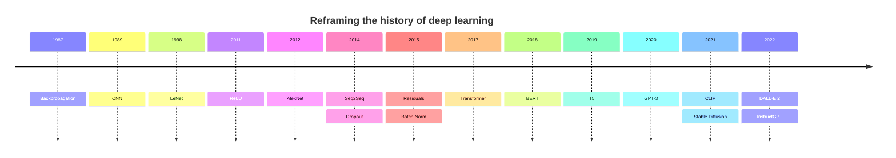

# Deep Learning from Scratch: Learning by Building

> *"What I cannot create, I do not understand."* — Richard Feynman

This repo is my journey through deep learning, done **by building every piece myself**. It starts from a single neuron, moves through backpropagation, and ends with the architectures that shaped modern AI: CNNs, ResNets, Transformers, BERT, GPT, CLIP, diffusion models and RLHF.

There's no `import torch` until I've built my own version of it. Each milestone is implemented from first principles, checked against the math, and only then compared with a reference library.

---

## The Timeline I'm Following



Each point on this timeline is a milestone in the repo: read the paper, derive the math, implement it from scratch, train it on a small dataset, and write down what I learned.

---

## Philosophy

1. **No black boxes.** Every forward pass and every gradient is written by hand before it gets abstracted away.
2. **Three levels of abstraction:**
   - **Level 0, pure Python.** Loops and scalars only, to make the math impossible to hide.
   - **Level 1, NumPy.** Vectorize everything and learn to think in matrices and shapes.
   - **Level 2, my own framework.** A PyTorch-like library (`Tensor`, autograd, `nn.Module`, optimizers) built from scratch and used for every later milestone.
3. **Verify, don't trust.** Gradient-check every new layer numerically, then compare outputs with PyTorch.
4. **Small data, real understanding.** Train on toy problems first (XOR, MNIST, tiny Shakespeare, CIFAR-10) so experiments run on a laptop.
5. **Notes alongside code.** Each milestone gets a short write-up covering the intuition, the math, the bugs I hit and the results.

---

## Roadmap

Legend: ✅ done · 🚧 in progress · ⬜ not started

### Phase 0: ML Fundamentals (the math I need)

| # | Topic | What I build | Status |
|---|-------|--------------|--------|
| 0.1 | Linear algebra refresher | Vectors, matrices, dot products, matmul by hand | ⬜ |
| 0.2 | Calculus & the chain rule | Derivatives, partial derivatives, Jacobians | ⬜ |
| 0.3 | Probability basics | Distributions, likelihood, softmax, entropy | ⬜ |
| 0.4 | Linear regression | Closed form + gradient descent, MSE loss | ⬜ |
| 0.5 | Logistic regression | Sigmoid, binary cross-entropy, decision boundary | ⬜ |
| 0.6 | Optimization | GD vs SGD vs mini-batch, learning-rate intuition | ⬜ |
| 0.7 | Generalization | Train/val/test splits, overfitting, bias–variance, regularization (L1/L2) | ⬜ |

### Phase 1: The Neuron → Backpropagation (1987)

| # | Topic | What I build | Status |
|---|-------|--------------|--------|
| 1.1 | Single neuron / perceptron | Weighted sum + step activation, AND/OR gates | ⬜ |
| 1.2 | Why XOR breaks a perceptron | Linear separability, hand-crafted XOR | ✅ |
| 1.3 | **Multi-layer perceptron + backprop (pure Python)** | 2→4→1 network that learns XOR with hand-derived gradients ([`dl.py`](deeplearning-implementaion/dl.py)) | ✅ |
| 1.4 | Vectorized MLP (NumPy) | Same network as matrix ops, batched training | ⬜ |
| 1.5 | MNIST with an MLP | Softmax + cross-entropy, ~97% accuracy target | ⬜ |
| 1.6 | Gradient checking | Finite-difference checker for every layer | ⬜ |

### Phase 2: Build My Own Framework (a mini-PyTorch)

This is the core of the project. Every phase after this one uses it.

| # | Component | What it does | Status |
|---|-----------|--------------|--------|
| 2.1 | Scalar autograd | `Value` object with a computation graph and `.backward()` | ⬜ |
| 2.2 | `Tensor` | N-d arrays (NumPy-backed) with broadcasting-aware gradients | ⬜ |
| 2.3 | Ops library | add, mul, matmul, sum, mean, exp, log, reshape, transpose, indexing | ⬜ |
| 2.4 | `nn.Module` | Parameters, submodules, `train()` / `eval()` modes | ⬜ |
| 2.5 | Layers | `Linear`, activations, `Sequential` | ⬜ |
| 2.6 | Losses | MSE, BCE, CrossEntropy (numerically stable) | ⬜ |
| 2.7 | Optimizers | SGD, Momentum, RMSProp, Adam, AdamW | ⬜ |
| 2.8 | Data utilities | `Dataset`, `DataLoader`, batching, shuffling | ⬜ |
| 2.9 | Weight init | Xavier/Glorot, He/Kaiming | ⬜ |
| 2.10 | Save / load | Serialize model state | ⬜ |
| 2.11 | (Stretch) GPU backend | CuPy or custom kernels | ⬜ |

### Phase 3: Convolutional Networks (1989 → 2015)

| Year | Milestone | What I build | Status |
|------|-----------|--------------|--------|
| 1989 | **CNN** | `Conv2d` forward/backward (naive loops → im2col), `MaxPool2d` | ⬜ |
| 1998 | **LeNet-5** | Full LeNet on MNIST | ⬜ |
| 2011 | **ReLU** | ReLU vs sigmoid/tanh; vanishing-gradient experiment | ⬜ |
| 2012 | **AlexNet** | Scaled-down AlexNet on CIFAR-10, data augmentation | ⬜ |
| 2014 | **Dropout** | Dropout layer (train vs eval behavior), overfitting comparison | ⬜ |
| 2015 | **Batch Norm** | BatchNorm forward/backward, running stats | ⬜ |
| 2015 | **Residuals (ResNet)** | Residual blocks, ResNet-18-style net on CIFAR-10 | ⬜ |

### Phase 4: Sequence Models (→ 2014)

| Year | Milestone | What I build | Status |
|------|-----------|--------------|--------|
| — | Embeddings | Embedding layer, word2vec-style training | ⬜ |
| — | RNN | Vanilla RNN + backprop through time, char-level language model | ⬜ |
| — | LSTM / GRU | Gated cells from scratch, compared with the vanilla RNN | ⬜ |
| 2014 | **Seq2Seq** | Encoder–decoder for a toy translation/reversal task | ⬜ |
| 2014 | Attention (Bahdanau) | Additive attention on top of Seq2Seq | ⬜ |

### Phase 5: Transformers & Language Models (2017 → 2022)

| Year | Milestone | What I build | Status |
|------|-----------|--------------|--------|
| 2017 | **Transformer** | Scaled dot-product attention, multi-head attention, positional encodings, LayerNorm, encoder–decoder | ⬜ |
| — | Tokenization | Byte-Pair Encoding (BPE) tokenizer from scratch | ⬜ |
| 2018 | **BERT** | Encoder-only model, masked-language-model pretraining (mini) | ⬜ |
| 2019 | **T5** | Text-to-text encoder–decoder, span corruption (mini) | ⬜ |
| 2020 | **GPT-3** (GPT-style) | Decoder-only causal LM on tiny Shakespeare; sampling (temperature, top-k, top-p) | ⬜ |
| 2022 | **InstructGPT** | Supervised fine-tuning → reward model → RLHF (PPO) on a small model | ⬜ |

### Phase 6: Multimodal & Generative Models (2021 → 2022)

| Year | Milestone | What I build | Status |
|------|-----------|--------------|--------|
| — | Autoencoder / VAE | Latent spaces, reparameterization trick | ⬜ |
| — | Diffusion basics (DDPM) | Forward noising, U-Net denoiser, sampling on MNIST | ⬜ |
| 2021 | **CLIP** | Image encoder + text encoder, contrastive loss on a small paired dataset | ⬜ |
| 2021 | **Stable Diffusion** (latent diffusion) | Diffusion in a VAE latent space with text conditioning (mini) | ⬜ |
| 2022 | **DALL·E 2** | CLIP-latent prior + diffusion decoder (conceptual mini version) | ⬜ |

> Phases 5 and 6 are **educational, small-scale reimplementations**. The goal is to understand the architecture and training procedure, not to match the original compute budgets.

---

## Repository Structure

Current:

```
Backpropagation/
├── README.md
└── deeplearning-implementaion/
    └── dl.py            # 1.3: MLP that learns XOR, backprop by hand (pure Python)
```

Planned (grows as milestones are completed):

```
Backpropagation/
├── README.md
├── 00-ml-fundamentals/
├── 01-neuron-to-backprop/
├── 02-framework/        # my mini-PyTorch: tensor, autograd, nn, optim, data
├── 03-cnn/              # CNN, LeNet, AlexNet, Dropout, BatchNorm, ResNet
├── 04-sequence-models/  # RNN, LSTM, Seq2Seq, attention
├── 05-transformers/     # Transformer, BPE, BERT, T5, GPT, InstructGPT
├── 06-generative/       # VAE, DDPM, CLIP, latent diffusion, DALL·E 2
└── notes/               # write-ups and derivations per milestone
```

---

## Getting Started

The early milestones use **only the Python standard library**.

```bash
# Requires Python 3.8+
python deeplearning-implementaion/dl.py
```

Expected output (XOR learned by a 2→4→1 network):

```
XOR Neural Network Results:
(0, 0) -> 0 (probability: 0.0001)
(0, 1) -> 1 (probability: 0.9999)
(1, 0) -> 1 (probability: 0.9998)
(1, 1) -> 0 (probability: 0.0004)
```

Later milestones will add:

```bash
pip install numpy matplotlib   # Level 1 (vectorized) + plots
pip install torch              # ONLY for verifying my framework's outputs/gradients
```

---

## How Each Milestone Is Done

For every item on the roadmap:

1. **Read**: the original paper (see below) plus one good explainer.
2. **Derive**: write the forward pass and gradients on paper.
3. **Implement**: from scratch, with no high-level library shortcuts.
4. **Verify**: run a numerical gradient check and compare with PyTorch where possible.
5. **Train**: on a small dataset, and plot loss and accuracy curves.
6. **Reflect**: write notes on what worked, what broke, and why.

---

## Papers

| Year | Paper |
|------|-------|
| 1986 | Rumelhart, Hinton & Williams: *Learning representations by back-propagating errors* |
| 1989 | LeCun et al.: *Backpropagation Applied to Handwritten Zip Code Recognition* |
| 1997 | Hochreiter & Schmidhuber: *Long Short-Term Memory* |
| 1998 | LeCun et al.: *Gradient-Based Learning Applied to Document Recognition* (LeNet-5) |
| 2010 | Glorot & Bengio: *Understanding the difficulty of training deep feedforward neural networks* |
| 2011 | Glorot, Bordes & Bengio: *Deep Sparse Rectifier Neural Networks* (ReLU) |
| 2012 | Krizhevsky, Sutskever & Hinton: *ImageNet Classification with Deep Convolutional Neural Networks* (AlexNet) |
| 2014 | Sutskever, Vinyals & Le: *Sequence to Sequence Learning with Neural Networks* |
| 2014 | Bahdanau, Cho & Bengio: *Neural Machine Translation by Jointly Learning to Align and Translate* |
| 2014 | Srivastava et al.: *Dropout: A Simple Way to Prevent Neural Networks from Overfitting* |
| 2014 | Kingma & Ba: *Adam: A Method for Stochastic Optimization* |
| 2015 | Ioffe & Szegedy: *Batch Normalization* |
| 2015 | He et al.: *Deep Residual Learning for Image Recognition* (ResNet) |
| 2017 | Vaswani et al.: *Attention Is All You Need* |
| 2018 | Devlin et al.: *BERT: Pre-training of Deep Bidirectional Transformers for Language Understanding* |
| 2019 | Raffel et al.: *Exploring the Limits of Transfer Learning with a Unified Text-to-Text Transformer* (T5) |
| 2020 | Brown et al.: *Language Models are Few-Shot Learners* (GPT-3) |
| 2020 | Ho, Jain & Abbeel: *Denoising Diffusion Probabilistic Models* |
| 2021 | Radford et al.: *Learning Transferable Visual Models From Natural Language Supervision* (CLIP) |
| 2021 | Rombach et al.: *High-Resolution Image Synthesis with Latent Diffusion Models* (Stable Diffusion) |
| 2022 | Ramesh et al.: *Hierarchical Text-Conditional Image Generation with CLIP Latents* (DALL·E 2) |
| 2022 | Ouyang et al.: *Training language models to follow instructions with human feedback* (InstructGPT) |

---

## Progress Log

| Date | Milestone | Notes |
|------|-----------|-------|
| — | 1.3 MLP + backprop (XOR) | Pure-Python 2→4→1 network, sigmoid activations, hand-derived gradients, 10k epochs |

---

## License

MIT. Use it, learn from it, build your own.
